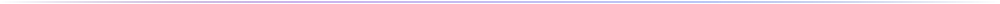

  

  
  
  
  

  
  
  
  
  
  
  
  

  <a href="#-contenu-du-dépôt">Contenu</a> ·
  <a href="#-identité-visuelle">Identité</a> ·
  <a href="#-sections-de-la-page">Sections</a> ·
  <a href="#-animations">Animations</a> ·
  <a href="#-objectifs-de-qualité">Qualité</a> ·
  <a href="#-démarrer">Démarrer</a>

## ✦ À propos

Ce dépôt réunit les **livrables de design** de la page d'accueil Zurumi : la maquette à calques, les design tokens et le cahier des charges d'intégration (Blade + Vue 3). Il sert de source de vérité partagée entre le design et le développement.

> [!NOTE]
> Les badges « cible » et « objectif » décrivent ce que l'intégration doit atteindre, pas des mesures déjà relevées. Le dépôt ne contient pas encore de code applicatif.

## ✦ Contenu du dépôt

| Fichier | Rôle |
|---|---|
| [`docs/design/zurumi-landing-1440.svg`](docs/design/zurumi-landing-1440.svg) | Maquette à calques, 1440 × 8581 px (même contenu que Figma) |
| [`docs/design/zurumi-tokens.json`](docs/design/zurumi-tokens.json) | Design tokens au format W3C DTCG (Tokens Studio / Variables Figma) |
| [`docs/design/MEGA_PROMPT_ZURUMI_LANDING.md`](docs/design/MEGA_PROMPT_ZURUMI_LANDING.md) | Cahier des charges d'intégration : architecture, animations, critères d'acceptation |
| [`assets/banner.svg`](assets/banner.svg) | Bandeau animé de ce README (SVG + CSS, sans script) |

**À ajouter** — `docs/design/zurumi-landing-demo.html`, la démo de référence citée par le cahier des charges comme source de vérité visuelle et d'animation. Elle n'est pas encore dans le dépôt.

## ✦ Identité visuelle

  
  
  
  
  
  
  

| Élément | Valeur |
|---|---|
| Dégradé de marque | `linear-gradient(100deg, #5D3587, #596FB7)` — boutons primaires, halos |
| Dégradé clair | `linear-gradient(100deg, #B794E6, #9DB0F2)` — texte d'accent, lignes de progression |
| Surfaces | `#0C0C12` / `#13131B` |
| Texte | blanc, atténué 60 %, discret 36 % |
| Police | Inter (400, 500, 600, 700) |
| Titres | graisse 600, interlettrage −0.045em, interligne 0.98 |
| Libellés | 10.5 px, majuscules, interlettrage 0.14em, graisse 600 |
| Rayons | 6 / 10 / 18 px, pilule 999 px |
| Grille | conteneur 1240 px, gouttières 40 px (22 px en mobile), navigation 56 px |
| Mouvement | `cubic-bezier(.2, .8, .2, 1)` — révélation 900 ms, survol 250 ms |

Le violet `#5D3587` est trop sombre pour du texte sur fond noir : il est réservé aux fonds, dégradés et halos. Le texte et les icônes d'accent utilisent `#B794E6` et `#9DB0F2`.

## ✦ Sections de la page

| # | Section | Résumé |
|---|---|---|
| 1 | **Hero** | Titre, formulaire d'inscription, statistiques, fenêtre de tableau de bord en perspective |
| 2 | **Cryptos** | Deux rangées de cartes en défilement opposé |
| 3 | **Application** | Disque dégradé, téléphone, quatre avantages |
| 4 | **Bannière ciel** | Plein écran, pluie fine, crête lumineuse, QR code |
| 5 | **Services** | Grille 2 × 2 : Achat rapide, Envoyer & Recevoir, Echanger, Retirer |
| 6 | **Mobile Money** | Téléphone couché en 3D, pièces flottantes |
| 7 | **Sécurité** | Bouclier 3D, grille de garanties |
| 8 | **Étapes** | Orbe lumineux, trois étapes en cycle automatique |
| 9 | **Globe** | Globe en points, cartes de cours |
| 10 | **Pied de page** | Liens, réseaux sociaux, retour en haut |

## ✦ Animations

Vingt et une animations (A1 à A21) sont spécifiées avec leur déclencheur, leur durée et leur courbe dans le [cahier des charges](docs/design/MEGA_PROMPT_ZURUMI_LANDING.md#8-spécification-des-animations-à-reproduire-à-lidentique).

- **Entrée dans le viewport** — titres révélés mot par mot, blocs en fondu décalé
- **Liées au scroll** — disque et téléphone, bannière ciel, bouclier, pièces flottantes
- **Continues** — colonnes de chiffres, défilements de cartes, pluie, globe, orbe
- **Survol et focus** — menus en verre dépoli, cellules de services et de sécurité, boutons

Règles : seuls `transform`, `opacity` et `filter` sont animés, un seul listener de scroll, un seul `IntersectionObserver`, canvas en pause hors écran, `prefers-reduced-motion` respecté.

## ✦ Objectifs de qualité

| Domaine | Objectif |
|---|---|
| Lighthouse mobile | Performance ≥ 90 · Accessibilité ≥ 95 · Bonnes pratiques ≥ 95 · SEO ≥ 95 |
| Web Vitals | LCP < 2,5 s · CLS < 0,05 |
| Poids | JavaScript de la page < 90 Ko compressé |
| Accessibilité | Contraste AA, navigation clavier complète, `:focus-visible` apparent |
| Responsive | 390, 768, 1024, 1440 et 1920 px, sans défilement horizontal |
| Résilience | Page lisible sans JavaScript, mouvement réduit respecté |

## ✦ Démarrer

1. **Voir la maquette** — ouvrir `docs/design/zurumi-landing-1440.svg` dans un navigateur, ou l'importer dans Figma pour retrouver les calques (`Nav`, `Hero`, `Coins`, `App`, `Sky`, `Produits`, `MobileMoney`, `Securite`, `Etapes`, `Globe`, `Footer`).
2. **Importer les tokens** — charger `docs/design/zurumi-tokens.json` dans Figma avec le plugin Tokens Studio, ou le convertir en Variables.
3. **Lancer l'intégration** — déposer les fichiers de `docs/design/` dans le dépôt du site Zurumi, ajouter la démo HTML, puis suivre le cahier des charges étape par étape (le plan est à valider avant toute implémentation).

> [!IMPORTANT]
> Les cours, montants, taux et statistiques de la maquette sont **fictifs**. Les mentions de sécurité et de conformité sont provisoires et restent à valider.

  Zurumi · Design UI/UX — maquette, tokens et spécification de la landing

